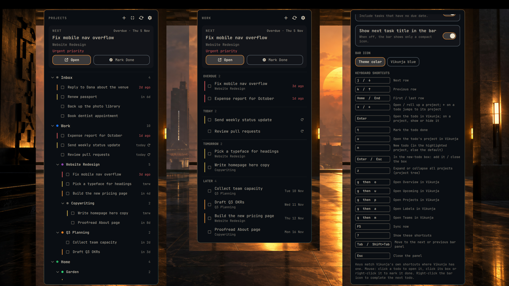
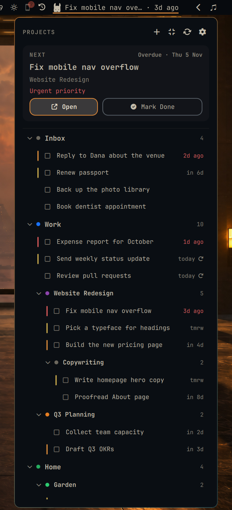
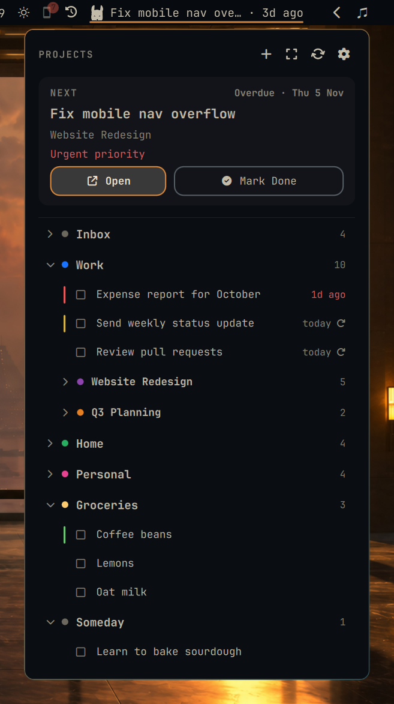
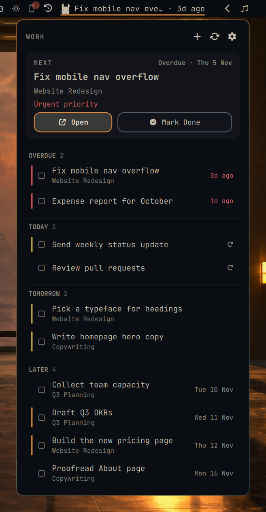
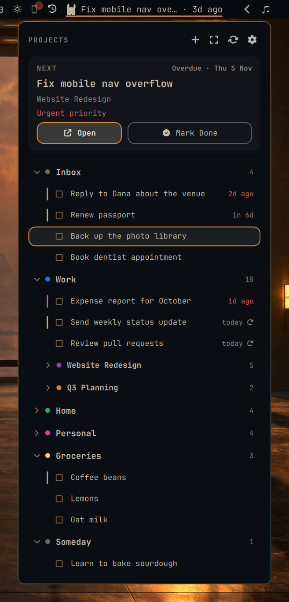
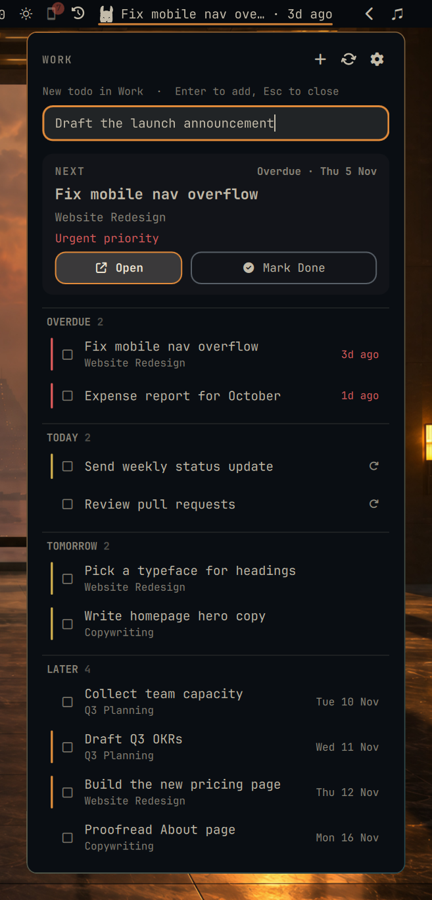
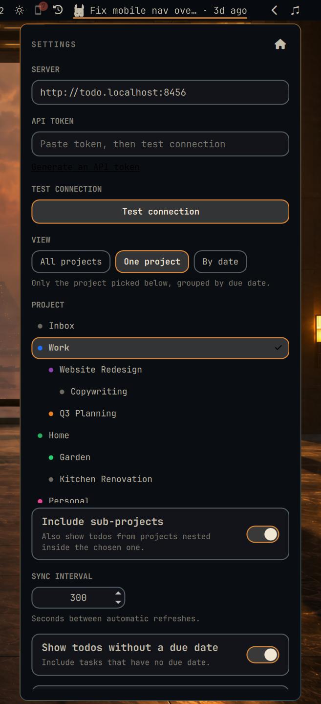
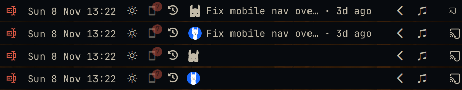

# Vikunja Projects for Omarchy



A Vikunja todo widget for the Omarchy bar that knows about projects. Based on
[org.jsongerber.vikunja](https://github.com/jsongerber/omarchy-vikunja-bar)
(MIT), with these additions:

- **All projects (nested)**: every project and sub-project as a tree. Click a
  project's chevron to roll it up or open it again. The panel remembers which
  projects are rolled up, per Vikunja instance, across shell restarts and
  reboots.
- **One project**: pick a project in the panel's settings page and see only
  its todos, grouped by due date. You can include its sub-projects too.
- **By date**: the original flat Overdue / Today / Tomorrow / Later list.
- The header has an expand-all / collapse-all button (or press <kbd>z</kbd>).
- Rolled-up projects still show how many open todos they hold, sub-projects
  included.
- Project colors from Vikunja are shown as dots.
- Empty projects are hidden by default. Turn on *Hide empty projects* to show them.
- Archived projects and saved filters are left out. Tasks whose project you
  can't see are gathered under **Other**.
- The bar label and tooltip follow the chosen scope.
- **Mark done**: click the box in front of any todo (or right-click the
  row, or right-click the bar icon to complete the next todo).
- **Add todos**: the **+** in the header (or press <kbd>n</kbd>) adds to the
  chosen project, or to Inbox. Hover a project row and click its **+** to add
  there. Enter adds the todo and keeps the box open for the next one; Esc
  closes it. New and completed todos show up straight away. Adding a todo also starts a sync right away, so its server-side details arrive without waiting for the interval.
- The bar icon is the Vikunja llama, drawn in your theme's bar color, or the
  official blue logo (`iconStyle: "color"`).
- Only open todos are fetched (up to 5,000), so large archives of done
  tasks don't crowd out the open ones.

The keyring token, size-limited fetching, test connection, and
right-click-to-complete work as in the original.

## Screenshots

| Project tree | Rolled up | One project |
| --- | --- | --- |
|  |  |  |
| **Keyboard cursor** | **Add a todo** | **Settings** |
|  |  |  |

Bar styles (theme color / Vikunja blue, with and without the title):



All screenshots use made-up demo data from `tools/fake-vikunja.py`.

## Install

```sh
omarchy plugin add https://github.com/sjwasko/omavikunja.git --enable
```

Then open the panel, click the gear, and enter your Vikunja URL and an API
token (Settings → API Tokens in Vikunja). The token is stored in your OS
keyring, never in `shell.json`. A token already stored by
`org.jsongerber.vikunja` is picked up automatically.

Requires Vikunja 2.4+ (API v2), `curl`, `jq` and `secret-tool` (libsecret).

## Remove

```sh
omarchy plugin remove sjwasko.omavikunja
```

Optionally clear the stored token and the saved show/hide state:

```sh
secret-tool clear service sjwasko.omavikunja
rm -rf ~/.local/state/omarchy/sjwasko.omavikunja
```

## Open it with a key

Plugins can't ship their own key, so add one line to `~/.config/hypr/bindings.lua`
(`SUPER + V` is Omarchy's paste, so this uses `SUPER + SHIFT + V`):

```lua
o.bind("SUPER + SHIFT + V", "Vikunja todos", { panel = "sjwasko.omavikunja" })
```

## Keyboard

Keys follow Vikunja's own shortcuts wherever Vikunja has one, so the same keys do the same thing in the panel and in the web app:

| Key | Action |
| --- | --- |
| `j` / `↓`, `k` / `↑` | Next / previous row |
| `Home` / `End` | First / last row |
| `→` / `←` | Open / roll up a project (`←` on a todo jumps to its project) |
| `Enter` | Open the todo in Vikunja; on a project, show or hide it |
| `t` | Mark the todo done |
| `u` | Open the todo's project in Vikunja |
| `g` then `o` / `u` / `p` / `a` / `m` | Open Overview / Upcoming / Projects / Labels / Teams in Vikunja |
| `?` | Show the shortcut list (Settings) |
| `n` | New todo (in the highlighted project, else the default) |
| `z` | Expand or collapse all projects |
| `F5` | Sync now |
| `Esc` | Close the panel |

`n`, `z` and `F5` are panel-only actions on keys Vikunja leaves free. `Delete`, which deletes a task in Vikunja, does nothing here.

## Settings (`~/.config/omarchy/shell.json`, or the gear icon in the panel)

| Setting | Default | Purpose |
| --- | --- | --- |
| `instance` | `""` | Base URL of your Vikunja instance. |
| `viewMode` | `"tree"` | `tree`, `project`, or `dates`. |
| `projectId` | `0` | Project shown in `project` view (pick it from the panel). |
| `includeSubprojects` | `true` | `project` view also shows sub-project todos. |
| `hideEmptyProjects` | `true` | Tree leaves out projects with no open todos. |
| `showNoDate` | `true` | Include todos without a due date. |
| `showTitle` | `true` | Show the next todo's title in the bar. |
| `syncInterval` | `300` | Seconds between refreshes (30–86400). |
| `iconStyle` | `"mono"` | `mono` (theme-colored llama) or `color` (official logo). |

Which projects are rolled up is saved in
`$XDG_STATE_HOME/omarchy/sjwasko.omavikunja/collapsed.json`, which defaults to
`~/.local/state/omarchy/sjwasko.omavikunja/collapsed.json`.

## IPC

```sh
omarchy shell sjwasko.omavikunja toggle|open|close|settings|refresh|expandAll|collapseAll
omarchy shell sjwasko.omavikunja view tree|project|dates
```

## Development

```sh
./install.sh                    # copy this checkout into ~/.config/omarchy/plugins
npm test
omarchy plugin validate .
python3 tools/fake-vikunja.py   # local stand-in API with demo data on :8456
```

## Credits and license

MIT; see [LICENSE](LICENSE). Based on
[jsongerber/omarchy-vikunja-bar](https://github.com/jsongerber/omarchy-vikunja-bar)
(MIT, © 2026 jsongerber).

- The bar icon is the Vikunja llama logo, taken from Vikunja's own frontend.
  Vikunja is a trademark of its owners; this plugin is an unofficial
  integration, not affiliated with or endorsed by the Vikunja project.
- The wallpaper in `preview.png` and the screenshots is "Dusk" from the
  [Blade Runner Omarchy theme](https://github.com/BVisagie/omarchy-blade-runner-theme)
  by Bernard Visagie, MIT licensed (© 2026 Bernard Visagie).
